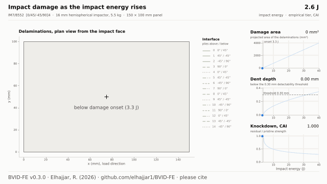

# Animations

BVID-FE renders 1920 × 1080 videos of the damage it predicts, for talks,
reports and teaching. Two scenes are available:

- **Energy sweep**: the delaminations of every interface growing as the
  impact energy rises, beside the damage area, the dent depth and the
  knockdown against energy.
- **Damage stack**: the delaminations through the thickness, as an exploded
  3D stack of plies with the camera orbiting it.

Each is rendered by the `bvidfe-animate` command or from Python. The
default output is an MP4 (H.264, `yuv420p`, 30 fps, CRF 18, `+faststart`),
which plays in PowerPoint, browsers, Teams and GitHub. A PNG sequence and a
reduced-size GIF preview are also available.

Every frame carries the citation of BVID-FE and its version in the footer.
If you show or publish an animation, please also cite the software (see
[Citation](#citation)).

## Install

MP4 output needs an ffmpeg executable. The `anim` extra installs one
(through `imageio-ffmpeg`, a bundled ffmpeg binary):

```bash
pip install "bvidfe[anim] @ git+https://github.com/elhajjar1/BVID-FE.git"
```

BVID-FE looks for ffmpeg in this order:

1. the `BVIDFE_FFMPEG` environment variable (an error if it names no
   executable);
2. matplotlib's `rcParams["animation.ffmpeg_path"]`, when it is set to a
   path that exists;
3. `ffmpeg` on `PATH`;
4. the binary of `imageio-ffmpeg` (the `anim` extra).

Without ffmpeg, `--format mp4` stops with an error that names the extra,
and `--format auto` writes a PNG sequence instead, with a warning. GIF and
PNG output need no ffmpeg.

## Energy sweep



*Preview (640 × 360, 12 fps). The 1080p MP4 is about 1.8 MB for 10 s.*

```bash
bvidfe-animate energy-sweep --material IM7/8552 \
    --layup 0,45,-45,90,0,45,-45,90,0,45,-45,90,0,45,-45,90 \
    --thickness 0.152 --panel 150x100 --energy-max 40 --out energy_sweep.mp4
```

The preview above is the same command with
`--format gif --duration 8 --out docs/animations/energy_sweep.gif`.

What the frame shows:

- **Left**: the plan view of the panel from the impact face. Each
  interface's delamination ellipse is drawn in its own colour, with a line
  style as well beyond the third interface. An interface that has not yet
  delaminated is muted in the key. When the impact was applied on a window
  (`AnalysisConfig.impact_panel`), its outline is drawn. When even the
  largest damage is small on the panel, the view zooms in on it, and the
  title says so.
- **Right**: the projected damage area, the dent depth and the knockdown
  (CAI or TAI) against energy. The curve up to the current energy is solid,
  the rest faint, and a marker follows the energy. The dent panel has the
  0.30 mm detectability threshold (`BVID_DENT_THRESHOLD_MM`) and says
  "now visible" once the dent reaches it.
- **Top**: the material, layup, impactor and panel, the current energy and
  the model tier.

The sweep runs one `BvidAnalysis` per keyframe energy: by default 60
(`empirical`) or 40 (`semi_analytical`) energies from 0.8 × the onset
energy to `--energy-max` (or `--energy`), plus the onset energy itself.
`--energy-min`, `--energy-max` and `--n-energies` change the grid. The clip
holds at the first energy, sweeps to the last and holds there. The `fe3d`
tier is refused: it would solve two finite-element models per energy.

## Damage stack

<video src="../animations/damage_stack.webm" autoplay loop muted playsinline width="640">
  Damage stack preview (WebM): docs/animations/damage_stack.webm
</video>

*Preview (640 × 360 WebM). The 1080p MP4 is about 4.5 MB for 10 s.*

```bash
bvidfe-animate damage-stack --material IM7/8552 \
    --layup 0,45,-45,90,0,45,-45,90,0,45,-45,90,0,45,-45,90 \
    --thickness 0.152 --panel 150x100 --energy 30 --out damage_stack.mp4
```

The preview above was made from that MP4 with
`ffmpeg -i damage_stack.mp4 -vf scale=640:-2:flags=lanczos -c:v libvpx-vp9 -crf 40 -b:v 0 -an docs/animations/damage_stack.webm`.

What the frame shows:

- Every ply as a sheet, the impact face (ply 0) on top. The delamination at
  each interface lies between its two plies, filled in its interface colour
  (the colours of the energy sweep). It elongates along the fibres of the
  ply below it, so the stack shows the helix that the plan view hides.
- Short lines in each ply's fibre direction, on the corner of the ply
  farthest from the camera, where they do not cover the delaminations.
  Stacked, these corners read as the stacking sequence.
- The impactor above the dent on the impact face.
- On the right, the damage area, dent depth, onset energy and each
  interface's ellipse size.

The intro drops the plies into place one by one, from the back face up;
then the camera orbits 360°. `--no-intro` leaves the intro out, for an orbit
that loops. With `--cscan FILE` the stack shows a measured damage state
instead of the impact model's (a C-scan has no impactor, so none is drawn).

## Output options

| Flag | Default | Meaning |
|---|---|---|
| `--out PATH` | `energy_sweep.mp4`, `damage_stack.mp4` | Output file. A PNG sequence goes into `<stem>_frames/` (or `PATH` itself when it has no suffix) |
| `--format` | `mp4` | `mp4`, `gif` (a preview), `png` (one file per frame) or `auto` (MP4 if ffmpeg is found, else PNG) |
| `--fps N` | 30 (GIF 12) | Frames per second |
| `--duration S` | 10 | Clip length in seconds |
| `--width`, `--height` | 1920 × 1080 (GIF 640 × 360) | Frame size: 16:9, even. Give one, and the other follows |
| `--preview` | off | Write three stills (t = 0, 0.5 and 1) as `<stem>_t0.00.png` ... instead of the clip |
| `--energy-min`, `--energy-max`, `--n-energies` | see above | The keyframe energies of `energy-sweep` |
| `--no-intro` | off | `damage-stack` without the assembly intro |

The analysis options are those of `bvidfe` (`--material`, `--layup`,
`--thickness`, `--panel`, `--boundary`, `--loading`,
`--transverse-stress-ratio`, `--energy` or `--cscan`, `--impactor-*`,
`--mass`, `--location`; `--tier` for `energy-sweep`), with the same
validation. Rendering takes about 0.2 s per 1080p frame, so about a minute
for 10 s at 30 fps, plus a few seconds for the analyses (about 0.4 s per
energy for `semi_analytical`). Smaller frames render faster.

## From Python

```python
from bvidfe.viz.anim import AnimationSpec, render_energy_sweep, render_damage_stack

render_energy_sweep(config, path="energy_sweep.mp4")
render_damage_stack(config, path="damage_stack.mp4", spec=AnimationSpec(duration_s=8))
```

See [Python API → Animations](python_api.md#animations) for the timeline
and still-preview functions.

## What the frames say, and what they do not

- **The numbers are model outputs.** The model runs once per keyframe
  energy. Between two keyframes only the drawing is interpolated (the
  ellipses' size, the marker's position, an interface fading in as it
  first delaminates). Every number printed on a frame, the energy
  included, is the nearest keyframe's model output. The footer gives the
  number of model runs.
- **The model tier** is on every frame of the energy sweep. The damage
  stack shows the impact model's damage, which is the same for every tier.
- **Below the onset energy** the plan view says "below damage onset
  (x.x J)", and so does the stack when there is no delamination.
- **Biaxial loads** (`--transverse-stress-ratio`, β ≠ 0) carry
  "experimental, not validated" on every frame, and TAI "not validated".
- **The stack is not to scale through the thickness.** The plies are spread
  apart (the frame gives the factor) and the dent is drawn on the impact
  face only, its depth shortened. In plan, ellipses, panel and impactor are
  to scale.
- **The delamination shapes are the model's**: one ellipse per interface
  from the impact mapping's template, not a measured or simulated shape.
  A C-scan input is drawn as supplied.
- **The same inputs give the same frames** on a given platform.
  Videos are made on demand and are not kept in the repository; the
  previews on this page are reduced-size copies.

## Citation

```text
Elhajjar, R. (2026). BVID-FE: Barely Visible Impact Damage residual-strength
analysis for composite laminates. https://github.com/elhajjar1/BVID-FE
```

The BibTeX entry is in the [README](https://github.com/elhajjar1/BVID-FE#citation),
and `CITATION.cff` is in the repository. The footer text comes from
`bvidfe.citation`, which a test keeps in step with `CITATION.cff`.
